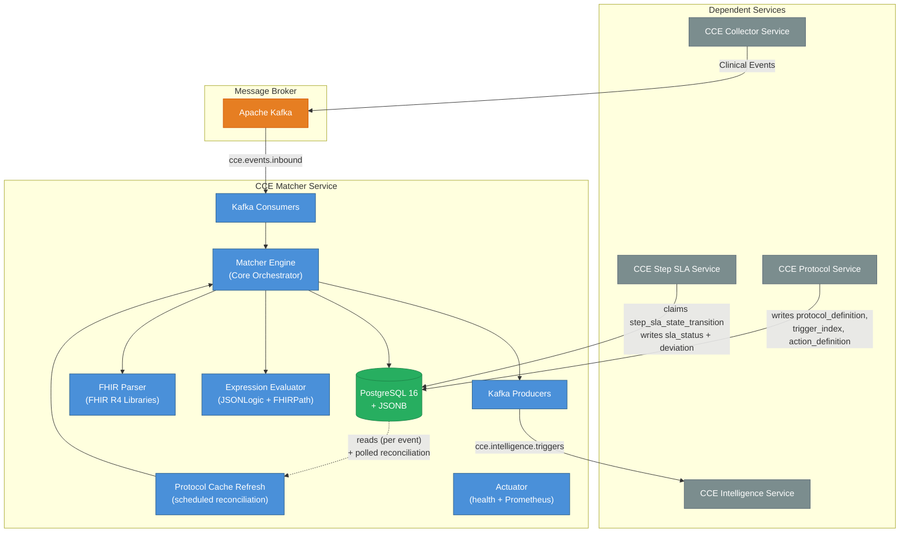
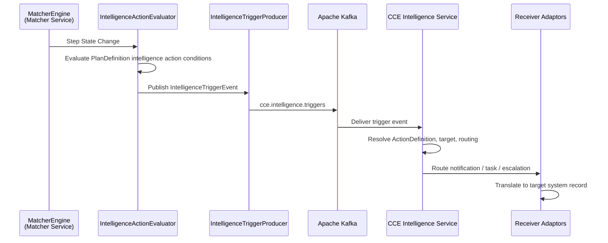
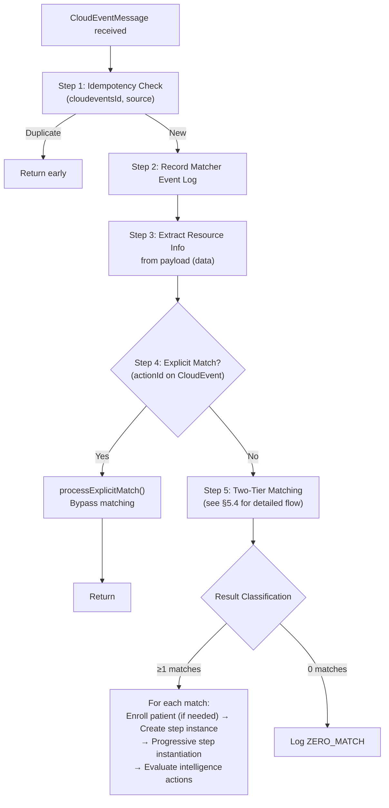
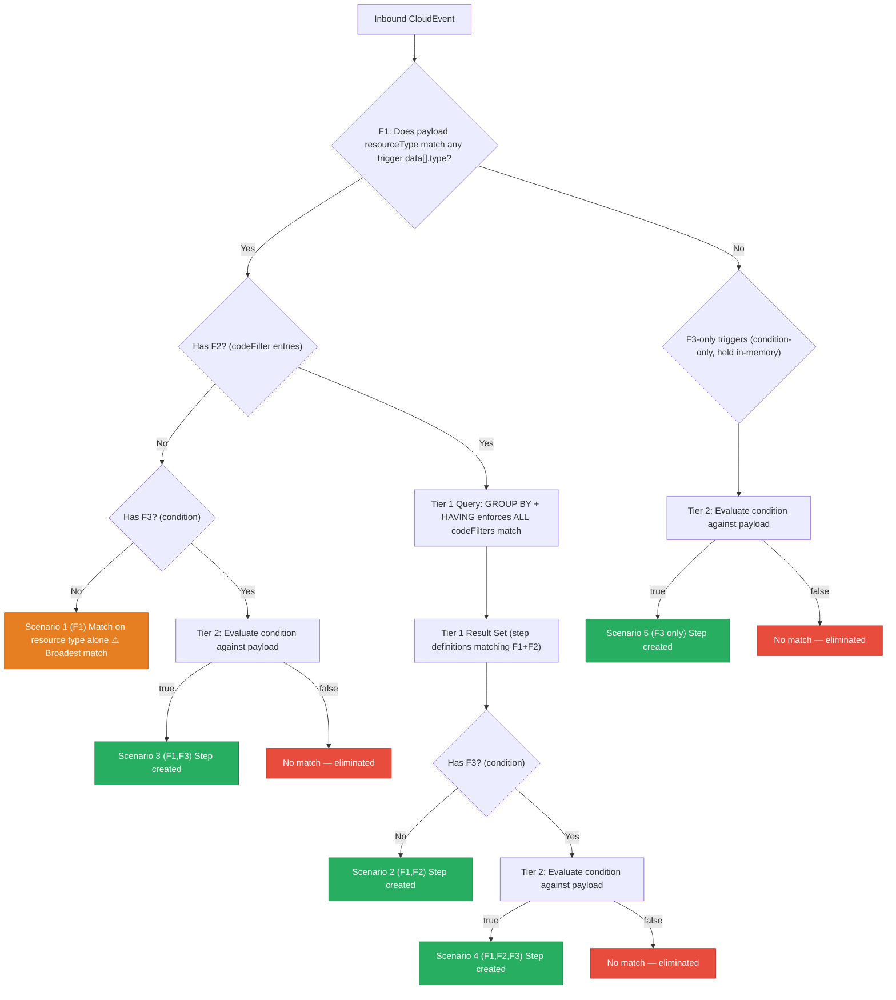
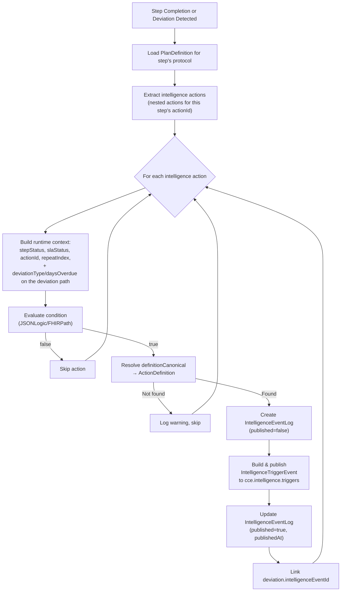
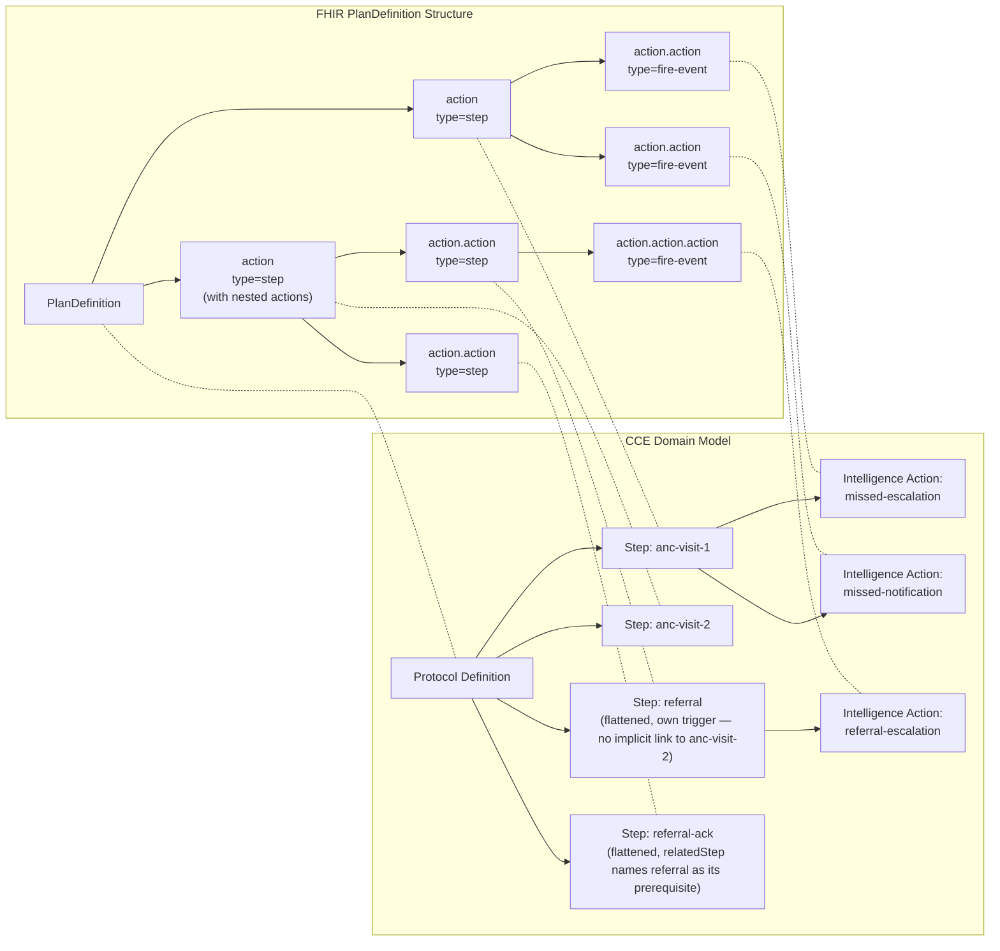
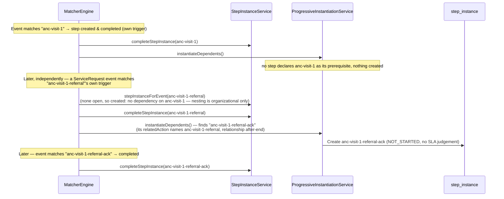
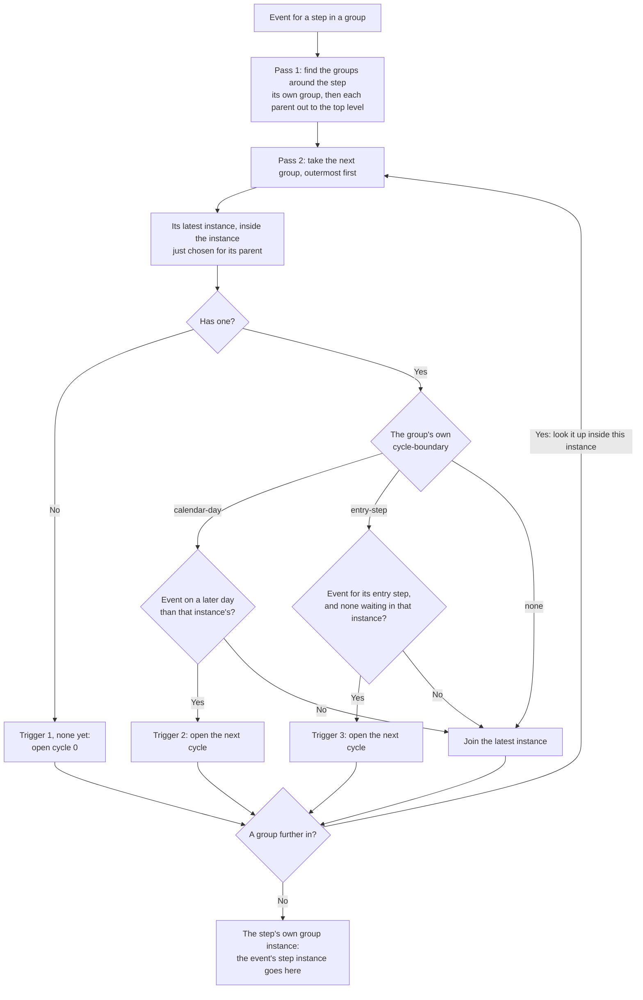
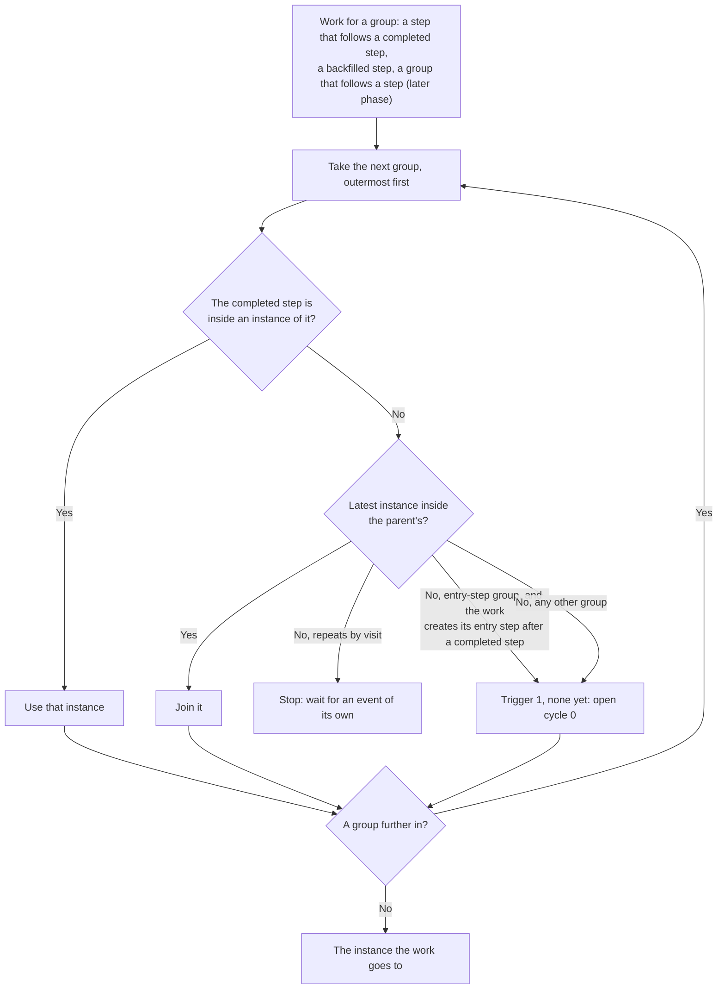

# Architecture & Design

## 1. System Context

The **CCE Matcher Service** is a core microservice within the **CCE** platform. It tracks patient adherence to clinical protocols defined as FHIR R4 `PlanDefinition` resources. To do this, it:

1. consumes clinical events
2. matches them against protocol steps
3. detects deviations
4. evaluates intelligence actions
5. publishes intelligence trigger events to downstream services

This section places Matcher among its neighbours. *Why* the platform is split across these services, and the topology as a whole, is covered once in
[`cce-common-util` → architecture-overview.md](https://github.com/openphc/cce-common-util/blob/release-2.0.0/docs/architecture-overview.md).



**No REST API.** This service is driven entirely by Kafka. The only HTTP it serves is `/actuator`
(health probes and Prometheus scraping). There is no application endpoint, and therefore no API Gateway
route to it.

**This service does NOT handle:**

- event collection/ingestion (CCE Collector Service)
- time-based SLA transitions and their deviations (CCE Step SLA Service)
- analytics
- alerting (CCE Intelligence Service)
- protocol and action-definition management (CCE Protocol Service). The Protocol Service owns the `protocol_definition`, `trigger_index` and `action_definition` tables Matcher reads.

### 1.1 SLA Transition Evaluation Contract

Time-based `sla_status` transitions are owned by the **CCE Step SLA Service**. Matcher's role is to
*schedule* them. When it creates a step, it writes one
[`step_sla_state_transition`](https://github.com/openphc/cce-common-util/blob/release-2.0.0/docs/data-dictionary.md#7-step_sla_state_transition)
row per threshold, in the same transaction. So a step never exists without its schedule.

Everything after that happens in the Step SLA Service:

- deciding which rows are due
- applying the status change
- recording the deviation

There is **no Kafka hop and no HTTP call** between the two. They meet on one table in the shared
database, with one writer per column.

**The invariant that matters here:**

- Matcher owns what an inbound event establishes: that the work happened, and when.
- The Step SLA Service owns every judgement of timeliness made from it.
- The two never write the same column.

Concretely, Matcher writes `step_status` and `completed_at`. It never writes `sla_status`. It inserts
these transition rows, and never touches one again:

1. the two deadlines, at creation
2. a `MET_CONDITION_REACHED`, at a completion on or before the due date

Step SLA reads that `completed_at` and settles the SLA from it when each row comes round.

`ORDER_VIOLATION` deviations stay in this service, because they are detected from the event itself at
completion rather than from a deadline passing.

The full contract is documented once, on the side that implements it. It covers:

- the two reasons a row is claimable
- what the applier does when an event arrived before its deadline
- retry and backoff

Where to find it:

- `cce-common-util` → [Architecture Overview §5](https://github.com/openphc/cce-common-util/blob/release-2.0.0/docs/architecture-overview.md#5-sla-transition-contract) — the contract
- `cce-step-sla-service` → [Architecture §3–4](https://github.com/openphc/cce-step-sla-service/blob/release-2.0.0/docs/architecture-overview.md#3-the-fetch-and-apply-cycle) — the implementation
- Column-by-column ownership: `cce-common-util` → [Data Dictionary §3](https://github.com/openphc/cce-common-util/blob/release-2.0.0/docs/data-dictionary.md#3-ownership)

### 1.2 Intelligence Service Contract

The **CCE Intelligence Service** is the downstream consumer of intelligence trigger events published by the Matcher Service. It:

1. receives structured trigger events via Kafka
2. resolves delivery targets
3. routes notifications, tasks, and escalations to the appropriate **Receiver Adaptors**

Communication is **exclusively via Kafka**. There are no direct service-to-service HTTP calls.



#### Message Contract

The Matcher Service publishes `IntelligenceTriggerEvent` messages to `cce.intelligence.triggers`. Each message contains all the context the Intelligence Service needs to route and deliver the action:

| Field | Purpose | Source |
|---|---|---|
| `id` | Unique event identifier | Generated UUID |
| `subject` | Patient identifier | Protocol instance subject |
| `actionId` | PlanDefinition step that triggered the intelligence action | Step instance's action ID |
| `protocolCanonical` | Protocol `url\|version` | Protocol definition canonical |
| `facilityId` | Facility where the event occurred | CloudEvent extension attribute |
| `metadata` | Additional context (due dates, timing, severity) | Step and deviation runtime state |
| `eventPayload` | Original FHIR resource payload from the inbound CloudEvent | CloudEvent `data` (null for the deviation path) |

See [Kafka Events §5.3](kafka-events.md#52-intelligencetriggerevent-outbound--cceintelligencetriggers) for the full message schema.

#### Ownership & Boundaries

| Aspect | Owner | Details |
|---|---|---|
| **Intelligence action evaluation** | Matcher Service | Evaluates PlanDefinition intelligence action conditions, resolves `definitionCanonical` to `ActionDefinition` |
| **Trigger event publishing** | Matcher Service | Publishes `IntelligenceTriggerEvent` to Kafka; creates `intelligence_event_log` record (published=false → true) |
| **`action_definition` table** | Matcher Service | Schema, writes, Flyway migrations — stores `ActivityDefinition` resources referenced by intelligence actions |
| **`intelligence_event_log` table** | Matcher Service | Tracks each intelligence action execution with evaluation context and Kafka event payload |
| **Event consumption & routing** | Intelligence Service | Consumes from `cce.intelligence.triggers`, resolves delivery targets, routes to Receiver Adaptors |
| **Notification/task delivery** | Intelligence Service + Receiver Adaptors | Translates intelligence events into system-specific records (SMS, in-app alerts, EMR tasks, escalation workflows) |
| **Kafka topic** | Shared | `cce.intelligence.triggers` — Matcher produces, Intelligence consumes |

> **Key invariant:** The Matcher Service is the **sole publisher** to `cce.intelligence.triggers`. It evaluates conditions and publishes structured trigger events. It has no knowledge of how they are delivered. The Intelligence Service is the sole consumer. It owns the routing logic, adaptor selection, and delivery confirmation. This separation keeps the Matcher Service **delivery-agnostic**. It also lets the Intelligence Service evolve its routing independently.

## 2. Technology Stack

| Category | Technology | Version | Purpose |
|---|---|---|---|
| **Runtime** | Java | 21 LTS | Language runtime |
| **Framework** | Spring Boot | 3.4.2 | Application framework |
| **Persistence** | Spring Data JPA / Hibernate | 6.x | ORM and data access |
| **Database** | PostgreSQL | 16 | JSONB, GIN indexes |
| **Migration** | Flyway | 10.x | Schema version management |
| **JSONB Mapping** | Hibernate 6 `@JdbcTypeCode(SqlTypes.JSON)` | 6.x | Native JPA ↔ PostgreSQL JSONB |
| **Messaging** | Spring Kafka | 3.x | Event-driven messaging |
| **FHIR** | HAPI FHIR (R4 structures) | 7.6.0 | FHIR R4 PlanDefinition parsing; FHIR spec version 4.0.1 |
| **Expression** | Apache Johnzon JsonLogic | 2.0.2 | Tier 2 conditional evaluation (JSONLogic) |
| **Expression** | HAPI FHIRPath | 7.6.0 | Tier 2 conditional evaluation (FHIRPath) |
| **Metrics** | Micrometer + Prometheus | 1.x | Application metrics |
| **Testing** | JUnit 5 + Mockito | 5.x / 5.x | Unit testing with mocked dependencies |
| **Integration testing** | EmbeddedKafka + H2 (PostgreSQL mode) | — | In-process broker and database; no Docker required |

## 3. Module & Package Structure

The service is one half of a **composite Gradle build**. Shared vocabulary lives in a sibling
repository, `cce-common-util`. This covers entities, enums, Kafka contracts and the FHIR layer. Sharing
it means this service and the CCE Step SLA Service cannot drift on the tables and messages they both touch.

```
cce-matcher-service/                       ← this repo
└── settings.gradle: includeBuild '../cce-common-util'
```

The build uses `includeBuild` rather than a published artifact. The two repos sit side by side, so a
change in `cce-common-util` is picked up on the next build. There is no publish step and no version bump.
**The sibling repo must be checked out next to this one or the build fails.** See
[Developer Setup](developer-setup.md).

### 3.1 What comes from `cce-common-util`

Anything more than one service must agree on:

- the shared entities and repositories
- the status enums
- the Kafka wire contracts (`CloudEventMessage`, `IntelligenceTriggerEvent`)
- the FHIR layer (`PlanDefinitionParser`, `ParsedProtocolCache`, `FhirExpressionEvaluator`)
- the shared services (`DeviationRecorder`, `StateTransitionHistoryWriter`, `IntelligenceActionEvaluator`,
  `ActionDefinitionResolver`, `SlaThresholdReader`)

That inventory is not restated here. See:

- [`cce-common-util` → library-reference.md](https://github.com/openphc/cce-common-util/blob/release-2.0.0/docs/library-reference.md) for the
  package-by-package reference
- [data-dictionary.md](https://github.com/openphc/cce-common-util/blob/release-2.0.0/docs/data-dictionary.md) for the nine shared tables

`SlaThresholdReader` is worth singling out. Matcher *writes* a step's SLA schedule and Step SLA *reads*
it. So how those rows are interpreted is shared code rather than duplicated on both sides.

### 3.2 What stays here (`org.openphc.cce.matcher`)

Matching is this service's job and nothing else's, so it does not move:

```
org.openphc.cce.matcher
├── MatcherServiceApplication.java   # @SpringBootApplication(scanBasePackages = "org.openphc.cce")
│                                    #   + @EntityScan / @EnableJpaRepositories("org.openphc.cce")
│                                    #   + @EnableScheduling
├── config/                          # KafkaConfig (consumer/producer factories, topics),
│                                    #   ObservabilityConfig (repository-backed gauges)
├── domain/
│   ├── entity/                      # Matcher-owned tables only: MatcherEventLog, Facility,
│   │                                #   ProtocolInstanceHistory, StepInstanceHistory
│   └── repository/                  # Those, plus ProtocolDefinitionRepository (fingerprint query)
│                                    #   and TriggerIndexRepository (the Tier 1 match)
├── kafka/consumer/                  # InboundEventConsumer — the only consumer
└── service/                         # MatcherEngine and the matching pipeline:
                                     #   EventCodesExtractor (codes; the resource type
                                     #   comes from common-util's ResourceTypeDetector),
                                     #   TriggerMatchingService,
                                     #   StepInstanceService (the step instance an event
                                     #   completes, and completing it), StepGroupService,
                                     #   StepInstanceScope, OrderViolationDetector,
                                     #   ProgressiveInstantiationService,
                                     #   MandatoryStepBackfillService, StepCreationService,
                                     #   StepSlaScheduleService, ProtocolDefinitionService,
                                     #   ProtocolInstanceService, MatcherEventLogService,
                                     #   StateTransitionHistoryWriter, FacilityService
                                     #   + records CodePathTriple, ConditionOnlyTrigger, MatchedStep
```

### 3.3 Bean discovery across the two packages

`org.openphc.cce.common` is not under this application class's default scan root, so all three scans are
widened explicitly on `MatcherServiceApplication`:

| Annotation | Why it is needed |
|---|---|
| `@SpringBootApplication(scanBasePackages = "org.openphc.cce")` | Picks up the `@Component`/`@Service` beans `cce-common-util` contributes |
| `@EntityScan("org.openphc.cce")` | `@Entity` types are not found by component scanning |
| `@EnableJpaRepositories("org.openphc.cce")` | Nor are Spring Data repository interfaces |

> One consequence worth knowing: `common.exception.GlobalExceptionHandler` is a `@ControllerAdvice`, so it
> is registered here too. It is inert, because this service has no controllers for it to advise. But it
> is on the context.

There is no `web/` package in this repo. The service exposes no REST API of its own.

## 4. Core Pipeline — MatcherEngine

The `MatcherEngine` is the central orchestrator. All inbound event processing flows through it:



### 4.1 Resource Extraction

Resource metadata is extracted from the CloudEvent **payload** (`data`), never from the envelope:

| Field | Extraction Paths |
|---|---|
| `resourceType` | `data.resourceType` (e.g., `"Observation"`, `"Encounter"`) |
| `allCodes` | every top-level field of `data` except `resourceType` and `id`, read by the shape the JSON has (below) |

The extractor **infers each field's shape** rather than consulting a list. So a trigger on a field nobody
has used before needs no code change:

| Shape found in the payload | Read as |
|---|---|
| object with a `coding` array (CodeableConcept), e.g. `code`, `serviceType`, `clinicalStatus` | each `coding` → (system, code) |
| object with a `code` (bare Coding), e.g. `Encounter.class` | the object itself → (system, code) |
| array of either of the above, e.g. `type`, `category` | item by item |
| array of objects with a `value` (Identifier list), e.g. `identifier` | (system, value) |
| string, e.g. `status` | ("", value) |

References, periods, numbers and anything else carry no code and are skipped. A coding with no `code`
falls back to its `display`.

The Protocol Service accepts any single top-level field name as a `codeFilter.path`
([`TriggerPath`](https://github.com/openphc/cce-common-util/blob/release-2.0.0/src/main/java/org/openphc/cce/common/fhir/TriggerPath.java)).
It rejects dotted or indexed expressions (`participant.type`, `type[0]`). This extractor cannot follow
them. They would be indexed and never matched. That would disable the action, since Tier 1 requires
*every* codeFilter to match.

The trade-off of not having a list: a misspelt field name loads cleanly and simply never matches.

The `resourceType` row above is read by
[`ResourceTypeDetector`](https://github.com/openphc/cce-common-util/blob/release-2.0.0/src/main/java/org/openphc/cce/common/fhir/ResourceTypeDetector.java),
in cce-common-util. It lives there because the Collector Service needs the same reading of the same payload.

### 4.2 Clinical Event Time Extraction

When an inbound event **completes** a step, the completion is attributed to the **clinical occurrence time**. That is when the act actually happened, not the time the event reached the service. Events can arrive late (offline sync, batch upload, retries, DLQ replay). Even then, this keeps these values accurate:

- a completed step's `completed_at`
- its `sla_status`
- the calculated due/missed dates of any **dependent steps**

`ClinicalEventTimeExtractor` derives this time from the FHIR payload. It uses a resource-type → clinical-time-field table. It handles FHIR's polymorphic `[x]` choice types by probing concrete field names in priority order.

It lives in [cce-common-util](https://github.com/openphc/cce-common-util/blob/release-2.0.0/docs/library-reference.md#clinicaleventtimeextractor) because the Collector Service stamps `inbound_event_log.event_time` from the same reading. The two services once held separate copies. Then an `Encounter` carrying both bounds was recorded there at `period.end` and judged here at `period.start`. So the audit trail and the SLA clock disagreed about when the visit happened.

| Resource type | Clinical-time fields (first match wins) |
|---|---|
| `Observation` | `effectiveDateTime` → `effectiveInstant` → `effectivePeriod.start` → `issued` → `effectivePeriod.end` |
| `Encounter` | `period.start` → `period.end` |
| `Procedure` | `performedDateTime` → `performedPeriod.start` → `performedPeriod.end` |
| `Immunization` | `occurrenceDateTime` |
| `MedicationAdministration` | `effectiveDateTime` → `effectivePeriod.start` → `effectivePeriod.end` |
| `MedicationDispense` | `whenHandedOver` → `whenPrepared` |
| `MedicationRequest` | `authoredOn` |
| `Condition` | `onsetDateTime` → `onsetPeriod.start` → `recordedDate` |
| `AllergyIntolerance` | `onsetDateTime` → `recordedDate` → `lastOccurrence` |
| `ServiceRequest` | `occurrenceDateTime` → `authoredOn` → `occurrencePeriod.end` |
| `Consent` | `dateTime` |
| `DiagnosticReport` | `effectiveDateTime` → `issued` → `effectivePeriod.end` |

A `Period`'s `end` bound is always the last-resort candidate in each row above. It reflects "when it finished," not when the clinical act occurred. So every other field is tried first, including that same Period's `start` where present.

Values are parsed leniently (partial precision `2026` / `2026-03` / full timestamps with offset). The extractor is **best-effort**. It returns nothing for an unmapped resource type, a missing field, or an unparseable value. The caller then falls back.

**Resolution order** for the completion time (`MatcherEngine.resolveOccurredAt`):

1. **Clinical time from the FHIR payload** (above) — only for FHIR payloads (`application/fhir+json`).
2. **CloudEvent envelope `time`** — the emitter/adaptor's transmission clock. It is stable across retries/DLQ replay. Used for non-FHIR (`application/json`) payloads and as the FHIR fallback.
3. **`now()`** — defensive last resort.

The resolved time is **clamped to `now()`** in `StepInstanceService.completeStepInstance`. A step cannot have completed in the future. A bad or skewed source clock must not push downstream schedules out. Unmapped resource types fall through to `now()`, which is never worse than the ingestion time.

**Enrollment anchoring:** the same `resolveOccurredAt(event)` result is also used as `ProtocolInstance.enrolled_at`. So a patient's enrollment reflects when they *clinically* entered care, not when the event was processed. This is consistent with step completion. The same holds for any downstream analytics that date-filter cohorts on `enrolled_at`.

Enrollment is idempotent, so `enrolled_at` is fixed by the first matching event to be processed. Unlike `completed_at`, enrollment does **not** apply the `completeStepInstance` future-clamp. It does not anchor step schedules; those anchor on `completed_at`. So its only clock guard is `resolveOccurredAt`'s own `now()` last resort.

> **Late-arriving completions:** ingestion lag can exceed a dependent step's offset. Then that step can be created with its `MISSED_DATE_REACHED` row already due. It transitions at the evaluator's next cycle, possibly recording a deviation. This is real-world-accurate: the step genuinely is late. It is a consequence of anchoring to clinical time.

### 4.3 Metric time semantics

Every number CCE reports is measured on one of two clocks, chosen by what the metric is about. Getting this distinction right keeps clinical KPIs stable when events arrive late:

> **Metric time semantics** — two clocks, chosen by metric type:
>
> - **Functional metrics** — clinical/business KPIs (e.g. adoption, matcher, deviations, event volume, referrals, patient cohorts). Measured on **clinical `event_time`**. That is when the clinical act actually happened, as carried on the inbound event. Date filters and daily rollups for these use `event_time`. So ingestion lag (offline sync, batch upload, retries, DLQ replay) never shifts the numbers.
> - **Technical / operational metrics** — pipeline health and ingestion throughput (e.g. events received, connector/queue health). Measured on **processing / system time** (`received_at` / `now()`). That is when the platform physically received or processed the data.
>
> Rule of thumb:
>
> - "when did it happen clinically?" → `event_time`
> - "when did our system handle it?" → `received_at` / `now()`

Within this service, `resolveOccurredAt(event)` is the concrete implementation of the clinical clock. Its order is clinical payload time → CloudEvent envelope `time` → `now()` fallback (see §4.2). It anchors **both**:

- step-completion timing (`step_instance.completed_at`)
- protocol enrollment (`protocol_instance.enrolled_at`)

So the functional metrics that date-filter off those columns are all measured on `event_time`.

Technical metrics stay on system time. `matcher_event_log.received_at` records ingestion. The ingestion/consumer counters in §8.1 count processing events as they happen.

## 5. Two-Tier Matching Algorithm

### 5.1 Tier 1 — Structural Match

Inverted index lookup on the `trigger_index` table using `GROUP BY` + `HAVING` to enforce **AND semantics** across all `codeFilter` entries:

```sql
SELECT protocol_definition_id, action_id
FROM trigger_index
WHERE resource_type = :resourceType
  AND CONCAT(path, '|', code_system, '|', code_value) IN (:codeTriples)
GROUP BY protocol_definition_id, action_id
HAVING COUNT(DISTINCT path) = (
    SELECT COUNT(DISTINCT t2.path)
    FROM trigger_index t2
    WHERE t2.protocol_definition_id = trigger_index.protocol_definition_id
      AND t2.action_id = trigger_index.action_id
      AND t2.resource_type = trigger_index.resource_type
);
```

The `:codeTriples` parameter is a list of `path|system|code` strings extracted from the inbound event payload. The correlated subquery counts the **total** distinct paths each action requires. This way, actions with different numbers of codeFilters are correctly evaluated in a single query.

The index is built at protocol load time. Each action's `TriggerDefinition.data[].codeFilter[]` is decomposed into `(resourceType, path, codeSystem, codeValue, protocolDefinitionId, actionId)` rows.

### 5.2 Condition-Only Triggers

Triggers that have no `data[]` section (only a `condition`) are **not indexed** in `trigger_index`. They are held in-memory and evaluated via Tier 2 for every inbound event. These are validated at protocol load time. A trigger with no `data[]` and no `condition` is rejected.

### 5.3 Tier 2 — Condition Evaluation

For each Tier 1 candidate, evaluates the trigger's `condition` expression.  **Triggers with no `condition` pass automatically**.

| Variable | Source |
|---|---|
| `event` | CloudEvent data payload |
| `patient` | Patient context (`patientId`, demographics) |
| `step` | Current step context (`actionId`, `repeatIndex`, `state`) |
| `protocol` | Protocol context (`protocolCanonical`, `status`) |

**Supported languages:**
- `text/jsonlogic` — via Apache Johnzon `JsonLogic`
- `text/fhirpath` — via FHIR `IFhirPath` engine (R4)
- Any other — rejected with `UnsupportedExpressionLanguageException`

### 5.4 How Matching Works — Step by Step

> **Terminology:** In FHIR, `PlanDefinition.action[]` defines the steps of a protocol. In CCE, each `action` is a **step definition**. It is a template that becomes a `step_instance` when matched for a specific patient. Throughout this section, "step definition" and "action" are used interchangeably.

A trigger definition has three filter components. Each component is **independent**. A trigger may use any combination:

| Component | FHIR Path | What it checks |
|---|---|---|
| **F1** — Resource type | `trigger.data[].type` | Does the payload's `resourceType` match? (e.g., `Encounter`) |
| **F2** — Code filters | `trigger.data[].codeFilter[]` | Do the payload's coded fields match the required `(path, system, code)` tuples? |
| **F3** — Condition | `trigger.condition` | Does the payload satisfy a JSONLogic/FHIRPath expression? |

> **F1 is implicit:** Every trigger that has a `data[]` section always has `data[].type` (the FHIR resource type). So F1 is present whenever F2 is present. A trigger with no `data[]` at all is a **condition-only trigger** (F3 only).

#### Five Exclusive Matching Scenarios

Every trigger in the system falls into **exactly one** of these five scenarios:



| Scenario | Components | Trigger Shape | Matching Path | Step Created When |
|---|---|---|---|---|
| **1** | **(F1)** | `data[].type` only — no `codeFilter[]`, no `condition` | Resource type match only | Payload `resourceType` matches trigger `data[].type`. **Broadest match** — every event of that type triggers a step. |
| **2** | **(F1,F2)** | `data[].type` + `codeFilter[]`, no `condition` | Tier 1 (GROUP BY + HAVING) | All code filters match — **no further evaluation needed** |
| **3** | **(F1,F3)** | `data[].type` + `condition`, no `codeFilter[]` | Resource type match → Tier 2 | `resourceType` matches AND condition evaluates to `true` |
| **4** | **(F1,F2,F3)** | `data[].type` + `codeFilter[]` + `condition` | Tier 1 → **reuses Tier 1 result** → Tier 2 | All code filters match AND condition evaluates to `true` |
| **5** | **(F3)** | `condition` only, no `data[]` | Tier 2 only (in-memory) | Condition evaluates to `true` (checked for **every** inbound event) |

> **Scenario 1 (F1) — caution:** A trigger with only `data[].type` and no `codeFilter[]` or `condition` will match **every** inbound event of that resource type (e.g., every `Encounter`). This is intentionally supported for use cases like "enroll patient on any encounter of this type." But protocol authors should be aware of the broad match scope.

#### Exclusivity

Each scenario is **mutually exclusive**. A trigger belongs to exactly one scenario, based on which components it defines:

- Has `data[]` with `codeFilter[]` and `condition`? → **Scenario 4 (F1,F2,F3)**
- Has `data[]` with `codeFilter[]` but no `condition`? → **Scenario 2 (F1,F2)**
- Has `data[]` with only `type` (no `codeFilter[]`) and `condition`? → **Scenario 3 (F1,F3)**
- Has `data[]` with only `type` (no `codeFilter[]`) and no `condition`? → **Scenario 1 (F1)**
- Has only `condition` (no `data[]`)? → **Scenario 5 (F3)**
- Has neither `data[]` nor `condition`? → **Rejected at protocol load time**

#### Tier 1 Result Reuse

Scenarios 2 and 4 both require Tier 1 matching (F1+F2). The Tier 1 query is executed **once**, and its result set is **reused**:

1. The `trigger_index` query runs once, returning all `(protocolDefinitionId, actionId)` pairs where all code filters match.
2. For **Scenario 2** step definitions (no condition): the Tier 1 result is final. Step instances are created immediately.
3. For **Scenario 4** step definitions (has condition): the same Tier 1 result is filtered through Tier 2 condition evaluation. There is **no re-query** of `trigger_index`.

```
Tier 1 Result Set ──┬── step definitions without condition ──► Scenario 2 → create step instances
                    │
                    └── step definitions with condition ──► Tier 2 eval ──► Scenario 4 → create step instances (if true)
```

#### Example Trigger (Scenario 4: F1,F2,F3)

Consider a step definition (`action`) with a trigger that requires an `Encounter` (F1) with **four** code filters (F2) and a condition (F3):

```json
"trigger": [
  {
    "type": "data-added",
    "data": [
      {
        "type": "Encounter",
        "codeFilter": [
          {
            "path": "type",
            "code": [{ "system": "http://openphc.org/encounter-types", "code": "anc-visit" }]
          },
          {
            "path": "status",
            "code": [{ "code": "finished" }]
          },
          {
            "path": "class",
            "code": [{ "system": "http://terminology.hl7.org/CodeSystem/v3-ActCode", "code": "AMB" }]
          },
          {
            "path": "serviceType",
            "code": [{ "system": "http://openphc.org/service-types", "code": "high-risk-anc" }]
          }
        ]
      }
    ],
    "condition": {
      "language": "text/jsonlogic",
      "expression": "{\"==\": [{\"var\": \"class.code\"}, \"AMB\"]}"
    }
  }
]
```

At **protocol load time**, this trigger is decomposed into 4 `trigger_index` rows (one per `codeFilter`):

| `resource_type` | `path` | `code_system` | `code_value` |
|---|---|---|---|
| `Encounter` | `type` | `http://openphc.org/encounter-types` | `anc-visit` |
| `Encounter` | `status` | *(empty)* | `finished` |
| `Encounter` | `class` | `http://terminology.hl7.org/CodeSystem/v3-ActCode` | `AMB` |
| `Encounter` | `serviceType` | `http://openphc.org/service-types` | `high-risk-anc` |

When an inbound `Encounter` event arrives:

1. **Tier 1 (F1+F2)** — The query matches on `resource_type = 'Encounter'`. It checks the inbound event's `path|system|code` triples against all 4 indexed rows. The correlated `HAVING` clause compares the matched path count against this action's total path count (4). If the payload is missing any one (e.g., no `serviceType` code), this step definition is eliminated.
2. **Tier 2 (F3)** — Since this step definition has a condition, the Tier 1 result is passed to Tier 2. The JSONLogic expression `{"==": [{"var": "class.code"}, "AMB"]}` is evaluated against the payload. Only if it returns `true` does this step definition produce a step instance.

> **Key point:** A step instance is created for **every** step definition that survives its matching scenario. Say 3 different step definitions match a single inbound event (e.g., one via Scenario 1, one via Scenario 2, one via Scenario 4). Then 3 separate step instances are created.

## 6. State Machines

### 6.1 Step Instance

A step carries two statuses that advance **independently**:

- `step_status` is driven by inbound events (this service).
- `sla_status` is driven by a time threshold being crossed (the Step SLA Service).

Neither transition touches the other.

Both state machines, and why the two columns are separate, are in `cce-common-util` →
[Architecture Overview §4](https://github.com/openphc/cce-common-util/blob/release-2.0.0/docs/architecture-overview.md#4-step-status-and-sla-status).
What follows is what *this* service does within them.

**Scheduling the SLA verdict on completion:** this service writes no `sla_status`, ever. At completion, it schedules the one verdict that has become answerable:

- **Completion on or before `dueDate`** (inclusive: at the instant counts). `StepSlaScheduleService.scheduleMetIfOnTime` writes a `MET_CONDITION_REACHED` row with `process_by` set to that `completed_at`. So the Step SLA Service records `MET` within a cycle, instead of at a deadline weeks away.
- **Completion after the due date.** This schedules nothing. The step's own deadline rows are already there to catch it. The step keeps whatever they reached: `OVERDUE` past the due date, `MISSED` past the missed date. So one row states both that the work was done and that it was late.

Timing is judged against the **clinical occurrence time** of the completing event (see §4.2), not the ingestion time. So an act that happened on time but reported late is still `MET`.

**Completability** depends on `step_status` alone. A step whose SLA is already `MISSED` is still completable by a late event. The previous model treated `MISSED` as terminal. So a late event created a second row, instead of recording the arrival against the step that was actually missed.

**Intelligence action evaluation:** On step completion and on `ORDER_VIOLATION` detection, the intelligence action evaluator is invoked. See §6.3 for details.

**Required behavior:** only `requiredBehavior=must` (from `PlanDefinition.action.requiredBehavior`) is mandatory. Anything else, an absent value included, is optional.

An optional step has no deadline. So it gets **no `step_sla_state_transition` rows at all**:

- no due date
- no missed date
- no `MET_CONDITION_REACHED`

Its `sla_status` stays null for good. Nothing was required of it. So there is nothing for it to breach, and no deadline it can be said to have beaten.

A PlanDefinition that gives an optional action a `tolerance-days` is rejected by the Protocol Service at load. `RequiredBehavior.isMandatory` is the single definition all of this shares with progressive instantiation.

**Backfilling unrecorded mandatory predecessors:** progressive instantiation only works *forward* from a completed step. A step can also be created reactively from its own trigger (`StepInstanceService.stepInstanceForEvent`). Then the mandatory steps that should have preceded it have **no `step_instance` row at all**. For example, a `treatment` event arrives for a patient whose `vitals-recording`, `consultation` and `diagnosis` were never reported. Those steps read as "not started" in the journey view. Having no row, they have no scheduled transition either. So they never surface as a deviation.

`MandatoryStepBackfillService.backfillMissingMandatorySteps` closes that gap. It runs after every completion. It looks for any mandatory step that:

1. is a transitive `relatedAction` predecessor of the progress observed so far (`PlanDefinitionParser.computeMustPredecessorSteps`), but
2. has no `step_instance` row.

Each such step is created with `step_status = NOT_STARTED` and no SLA judgement yet. The rules:

- **Scope — predecessors only.** The backfill covers work that is *already late*. It never covers mandatory work still ahead in the chain.
  - Materializing steps still ahead would stamp them with this completion's time. That would flatten the schedule their own `relatedAction` offsets define (e.g. `lab-results`' `+3d` after `lab-order`).
  - So they are left to progressive instantiation. It creates them on their predecessor's completion, with the intended due dates.
  - For example, completing `chief-complaints` does **not** backfill `diagnosis`. A later `treatment` completion does, because `diagnosis` is then a predecessor of observed progress.
- **Dates.**
  - The scheduled due date is the clinical completion time of the step that revealed the gap. Every backfilled step is a prerequisite that should already have happened. So they are all equally past due, and there is no future schedule left to preserve among them.
  - The missed threshold is derived from the step's `tolerance-days` extension.
  - The Step SLA Service then drives `sla_status` from null to `OVERDUE` to `MISSED`. So mandatory work that is never recorded surfaces as a `MISSED` deviation.
  - If the event does arrive later, `stepInstanceForEvent` picks the row up and completes it. Matcher does not judge timeliness. So the breach the Step SLA Service records still reflects the `completed_at` it finds.
  - A step with no `tolerance-days` gets no missed threshold. It therefore never advances past `OVERDUE`.
  - Only mandatory steps are scheduled at all. `StepSlaScheduleService` writes no transition row for a step whose `requiredBehavior` is not `must`. Nothing was required of it, so nothing can be breached.
- **Ordering after a completion.** `MatcherEngine` runs backfill *after* the order-violation check (`OrderViolationDetector`).
  - So a freshly backfilled row is never counted as an incomplete prerequisite for the completion that revealed it. This pass does not invent an `ORDER_VIOLATION`.
  - Subsequent completions do see those rows. So a genuinely out-of-order journey raises `ORDER_VIOLATION` from the next completion onward.
- **Idempotent.** A mandatory step that already has any row, in any state, is left alone. That covers a row that is pre-existing, terminal, or created earlier in the same transaction by progressive instantiation. There is one row per step (`repeat_index` 0), regardless of `timing.repeat.count`. This is a placeholder for work never recorded, not a scheduled recurrence.

### 6.2 Protocol Instance

`ProtocolInstanceStatus` defines `ACTIVE`, `COMPLETED`, `WITHDRAWN`, and `EXPIRED`. But **no code currently transitions an instance out of `ACTIVE`**. There is no mechanism to complete or withdraw one, and no automatic completion.

Every enrolled instance stays `ACTIVE`. Its steps still progress through their own status machines (§6.1) and raise deviations as usual. Protocol-level completion criteria are not yet defined.

### 6.3 Intelligence Action Evaluation

Intelligence actions are modeled as **nested actions** within a PlanDefinition step (`action.action[]`). Each intelligence action defines:

- a condition (JSONLogic/FHIRPath) evaluated against step runtime state
- a `definitionCanonical` pointing to an `ActivityDefinition` that defines the action to take. The `ActivityDefinition` is stored in the `action_definition` table.

Intelligence action evaluation is triggered on any Step State change. Example:
1. **On deviation detection** — when an `ORDER_VIOLATION` is detected on completion. (`OVERDUE`/`MISSED` deviations are recorded by the CCE Step SLA Service. That service owns intelligence evaluation for them.)
2. **On step completion** — when a step is completed by an inbound event (for actions like "notify on late completion")



#### Runtime Context Variables

Two contexts are built, one per entry point. JSONLogic rules address them as `event.<key>`.

| Variable | Type | Value | Completion | Deviation |
|---|---|---|---|---|
| `stepStatus` | String | `not-started` or `completed` | ✅ | ✅ |
| `slaStatus` | String | `pending`, `overdue`, `missed`, `met` | ✅ | ✅ |
| `actionId` | String | Step definition action id | ✅ | ✅ |
| `repeatIndex` | Integer | 0-based repeat counter | ✅ | ✅ |
| `dueDate` | String (ISO-8601) | The step's scheduled due threshold, when it has one | ✅ | ✅ |
| `completedAt` | String (ISO-8601) | Completion time, when set | ✅ | — |
| `deviationType` | String | `order_violation` — the only deviation this service raises | — | ✅ |
| `daysOverdue` | Long | Days past the due threshold, floored at 0. Present only when the step has a due threshold | — | ✅ |
| `daysPastMissedDate` | Long | Days past the missed threshold, floored at 0. Present only when the step has a missed threshold | — | ✅ |

> The thresholds behind `dueDate`, `daysOverdue` and `daysPastMissedDate` are read from
> `step_sla_state_transition.process_by`, not from the step row.
>
> `deviationType` never carries `overdue` or `missed` here. Those deviations are raised by the SLA
> CCE Step SLA Service. That service owns intelligence evaluation for them.

#### Domain-to-FHIR Concept Mapping

The table below maps CCE domain concepts to their FHIR PlanDefinition counterparts:

| CCE Domain Concept | FHIR PlanDefinition Element | Description |
|---|---|---|
| **Protocol Definition** | `PlanDefinition` | The clinical protocol (e.g., ANC High-Risk Monitoring) |
| **Protocol Step** | `PlanDefinition.action` (type=step) | A step in the protocol with its own trigger (e.g., "ANC Visit 2"). Nested actions of type "step" are flattened to peer-level steps. |
| **Flattened Sub-Step** | `PlanDefinition.action.action` (type=step) | A nested step flattened into a peer-level step. Nesting groups it with its parent for trigger indexing only. Any dependency on the parent or on sibling sub-steps must be declared explicitly via `relatedAction`. |
| **Intelligence Action** | `PlanDefinition.action.action` (type=fire-event) | A nested action that defines a conditional intelligence evaluation |



Each **intelligence action** (`PlanDefinition.action.action`) contains:
- `id` — unique identifier (mapped to `stepActionId` in `intelligence_event_log`)
- `type` — **required** coding `fire-event`, with the HL7 system `http://terminology.hl7.org/CodeSystem/action-type`. The step it belongs to has `step`, with the CCE system `http://openphc.org/fhir/CodeSystem/action-type`. An action without a `type` is rejected at load
- `condition[kind=applicability]` — JSONLogic/FHIRPath expression evaluated against step runtime state
- `definitionCanonical` — reference to an `ActivityDefinition` that defines the action to take
- `extension` — **required** severity and destination metadata (rejected at parse time if missing)

#### PlanDefinition Intelligence Action Structure

```json
{
  "id": "anc-visit-2",
  "title": "ANC Visit 2",
  "type": {
    "coding": [{ "system": "http://openphc.org/fhir/CodeSystem/action-type", "code": "step" }]
  },
  "trigger": [{ "..." : "..." }],
  "action": [
    {
      "id": "anc-visit-2-missed-escalation",
      "type": {
        "coding": [{ "system": "http://terminology.hl7.org/CodeSystem/action-type", "code": "fire-event" }]
      },
      "condition": [{
        "kind": "applicability",
        "expression": {
          "language": "text/jsonlogic",
          "expression": "{\"and\": [{\"==\": [{\"var\": \"slaStatus\"}, \"missed\"]}, {\">\": [{\"var\": \"daysOverdue\"}, 3]}]}"
        }
      }],
      "definitionCanonical": "ActivityDefinition/anc-escalation-notification|1.0",
      "extension": [
        {
          "url": "http://openphc.org/fhir/StructureDefinition/intelligence-severity",
          "valueCode": "high"
        },
        {
          "url": "http://openphc.org/fhir/StructureDefinition/intelligence-destination",
          "valueCode": "openMRS"
        }
      ]
    }
  ]
}
```

#### Action Definitions

`ActionDefinition` entities store FHIR `ActivityDefinition` resources. They define what CCE does when an intelligence action fires:

| Field | Description |
|---|---|
| `canonicalUrl` + `version` | Unique identifier, referenced by `definitionCanonical` in PlanDefinition intelligence actions |
| `actionType` | FHIR `ActivityDefinition.kind`: `CommunicationRequest`, `Task`, `ServiceRequest` |
| `definition` | Full ActivityDefinition JSON (message template, routing config) |

> **Note:** `severity` and `intelligenceDestination` are **required** on the PlanDefinition intelligence action extensions (`intelligence-severity`, `intelligence-destination`). They are not stored on `action_definition`. PlanDefinitions missing these extensions are rejected at parse time.

#### Intelligence Event Logging

`IntelligenceEventLog` records track each intelligence action execution in a single flat row for auditability:

| Field | Description |
|---|---|
| `published` | `false` → `true` (on successful Kafka publish) |
| `event_payload` | Complete `IntelligenceTriggerEvent` JSON published to Kafka |
| `trigger_reason` | Why the action fired: `missed`, `order_violation`, `completion` |
| `evaluation_context` | Runtime variables passed to the condition evaluator |

All execution and evaluation context is stored in a single row — no FK constraints, no joins required. See [Data Dictionary §11](https://github.com/openphc/cce-common-util/blob/release-2.0.0/docs/data-dictionary.md#11-intelligence_event_log).

### 6.4 Flat Step Model (Nested Actions Flattened)

Nested `PlanDefinition.action.action[]` entries with type `"step"` are **flattened** into peer-level steps at parse time by `extractSteps()`. There is no parent-child hierarchy between steps. All steps (top-level and nested) are stored uniformly in `step_instance` without any `parent_step_id`. Relationships between steps are expressed exclusively via `relatedSteps` (derived from FHIR `relatedAction`). The one exception is an action with `groupingBehavior: logical-group`. It is a step group, not a step, and is never flattened into one (§6.5).

**How `relatedAction` sets the order.** A `relatedAction` is written on the later step, and names the step it follows. For example, `{"id": "lab-results", "relatedAction": [{"actionId": "lab-order", "relationship": "after-end", "offsetDuration": "3d"}]}` reads: lab-results is due 3 days after lab-order is done.
- **`after-end` is the only supported relationship,** and the default: a `relatedAction` with no `relationship` means `after-end`.
- **Any other relationship is refused at load** (`PlanDefinitionParser.validateRelationships`): `after`, `after-start`, `before-*` and `concurrent-*`.
- **Protocols stored before that check keep working.** The matcher still reads the old relationships as it always did. A `before-*` is read from the other step, an `after-start` counts from the earlier step's due date, and a `concurrent-*` sets no order.

`PlanDefinitionParser.buildDependencyGraph()` turns the `relatedAction`s into one graph of which step follows which. It can be read both ways:
- `successorsOf`: the steps that follow a step. Progressive instantiation uses it when a step is done.
- `predecessorsOf`: the steps a step follows. Order checks and backfill use it.

A `relatedAction` naming an action the protocol doesn't have sets no order. The Protocol Service warns about it at load (`PlanDefinitionParser.findDanglingRelatedActions`), so an author who expected it to order the steps finds out.

**Key design decisions:**
- `StepMetadata` is a flat record with 9 fields (no `subSteps` list): `id`, `title`, `triggers`, `relatedSteps`, `timing`, `toleranceDays`, `requiredBehavior`, `intelligenceActions`, `groupId`
- Plain nesting is **organizational only**. It groups a sub-step under its enclosing action. It does **not** create an implicit `relatedStep`/dependency link.
  - Ordering between a parent and its sub-steps (and among sub-steps) must be expressed explicitly via `relatedAction`.
  - A sub-step with no explicit prerequisite is created independently whenever its own trigger fires (`StepInstanceService.stepInstanceForEvent`). This is exactly like a top-level step. It does not wait for its parent to complete.
  - Whether a sub-step waits on its parent is the protocol author's clinical decision, expressed with `relatedAction`.
- `groupId` is the step's nearest enclosing step group, or null outside any group (§6.5). Plain nesting under a step records nothing.
- A sub-step whose `relatedAction` names a sibling as its prerequisite is flattened as-is and created progressively via standard progressive instantiation (`ProgressiveInstantiationService`)
- **Fan-in** — a step may declare several prerequisites. It is instantiated only once none of the others is still outstanding. Outstanding means `step_status=NOT_STARTED` with `sla_status` still null or `OVERDUE`. So its due date anchors to the last prerequisite to finish, rather than whichever completed first. A prerequisite with no `step_instance` row at all does not block. Waiting on work that may never be recorded would strand the dependent step permanently.
- All trigger indexing uses the step's **plain action ID** (e.g., `"anc-visit-1-referral"`)
- Intelligence actions are found via flat lookup by `actionId` (no tree traversal needed)

#### actionId Validation

All action IDs in a PlanDefinition are validated at load time via `validateActionIds()`:
- **Mandatory:** Every action at every nesting level must have a non-blank `id`
- **Unique:** No two actions (at any level) may share the same `id`

Violations are rejected with `IllegalArgumentException` at protocol load time.

#### Classification Rules

Actions at ALL levels are classified by type (`type.coding[0]` — both `system` and `code` are validated):

| System URI | Code | Classification | Description |
|---|---|---|---|
| `http://openphc.org/fhir/CodeSystem/action-type` | `"step"` | Step | Trigger-based action (has triggers, tracked as step instance) |
| `http://terminology.hl7.org/CodeSystem/action-type` | `"fire-event"` | Intelligence Action | Conditional intelligence evaluation (nested only) |
| *(missing or unrecognized)* | | **Rejected** | `IllegalArgumentException` at load time |

Every action **must** have an explicit `type` coding with the correct system URI:

- `"step"` uses the CCE custom CodeSystem.
- `"fire-event"` uses the HL7 standard CodeSystem (extensible binding per FHIR R4 `PlanDefinition.action.type`).

#### Flattening Example

Given this PlanDefinition structure:
```json
{
  "id": "anc-visit-1",
  "type": { "coding": [{ "system": "http://openphc.org/fhir/CodeSystem/action-type", "code": "step" }] },
  "trigger": [{ "data": [{ "type": "Encounter", "codeFilter": ["..."] }] }],
  "action": [
    {
      "id": "anc-visit-1-referral",
      "type": { "coding": [{ "system": "http://openphc.org/fhir/CodeSystem/action-type", "code": "step" }] },
      "trigger": [{ "data": [{ "type": "ServiceRequest", "codeFilter": ["..."] }] }]
    },
    {
      "id": "anc-visit-1-referral-ack",
      "type": { "coding": [{ "system": "http://openphc.org/fhir/CodeSystem/action-type", "code": "step" }] },
      "trigger": [{ "data": [{ "type": "ServiceRequest", "codeFilter": ["..."] }] }],
      "relatedAction": [{ "actionId": "anc-visit-1-referral", "relationship": "after-end" }]
    },
    {
      "id": "anc-visit-1-escalation",
      "type": { "coding": [{ "system": "http://terminology.hl7.org/CodeSystem/action-type", "code": "fire-event" }] },
      "condition": [{ "kind": "applicability", "expression": { "language": "text/jsonlogic", "expression": "..." } }],
      "definitionCanonical": "ActivityDefinition/anc-escalation|1.0"
    }
  ]
}
```

`extractSteps()` produces 3 flat `StepMetadata` entries:
1. `anc-visit-1` — top-level step with its trigger
2. `anc-visit-1-referral` — flattened with no `relatedSteps` of its own and no implicit dependency on its parent. It has its own trigger (`ServiceRequest`). So it is created independently whenever that trigger fires, rather than waiting for `anc-visit-1` to complete.
3. `anc-visit-1-referral-ack` — flattened with `relatedSteps: [{actionId: "anc-visit-1-referral", relationship: "after-end"}]`. This is its own explicit `relatedAction`, naming its prerequisite. It is created progressively when `anc-visit-1-referral` completes.

The intelligence action (`anc-visit-1-escalation`) is extracted into `anc-visit-1`'s `intelligenceActions` list.

#### Step Lifecycle (Flat)



#### Trigger Indexing

All steps (regardless of original nesting level) are indexed in `trigger_index` with their plain action ID:

| `action_id` | Source |
|---|---|
| `anc-visit-1` | Top-level action |
| `anc-visit-1-referral` | Originally nested under anc-visit-1, now a peer |
| `anc-visit-1-referral-ack` | Originally nested under anc-visit-1, now a peer |

### 6.5 Step Groups

An action typed `step` with `groupingBehavior: logical-group` is a **step group**. It is a set of steps that belong together clinically, such as one antenatal-care visit.
- A group is never matched to an event, and never becomes a `StepMetadata`. Only its steps do. `PlanDefinitionParser.extractGroups` returns groups separately.
- Each instance of a group for an enrollment is one `step_group_instance` row. A nested group's instance points to its parent's instance.
- Each step row points to the instance of its own group, through `step_instance.step_group_instance_id`.

The design is in [design-repeating-step-groups.md](design-repeating-step-groups.md). What is built when is in [implementation-plan-step-groups.md](implementation-plan-step-groups.md).

**Group instance creation triggers:** Anything that needs a group instance joins the group's latest instance, unless a trigger opens a new one. The triggers are the same at every level of nesting, and are checked from the top-level group down (`StepGroupService.opensNewGroupInstance`).

An event for a group is an event for any step inside it: a step directly in the group, or a step in one of its nested groups.

1. **None yet.** The group has no instance yet. For a nested group, that means none inside its parent's instance.
2. **New calendar day.** For a group with `cycle-boundary: calendar-day`: an event on a later clinical day than the latest instance's day.
   - Days are counted in the deployment's time zone (`cce.step-groups.calendar-zone`).
   - An instance's day is the day of its `opened_at` in that zone.
   - An event for the same day, or an earlier one, joins the latest instance.
   - This is the Rwanda patient journey: one instance per visit.
3. **Entry step.** For a group with `cycle-boundary: entry-step`: an event for the group's entry step.
   - The group names its entry step by action id, in the `cycle-entry-step` extension (`GroupMetadata.entryStepId`).
   - The entry step can be a step directly in the group, or a step in one of its nested groups. It must not wait on anything inside the group.
   - Normally, each event for the entry step starts the next cycle. This is a Consultation that can happen twice in one visit.
   - The exception is a latest cycle that already has the entry step waiting for its event, as a `NOT_STARTED` step instance. That only happens when the protocol expects the entry step (below). The event then completes that step instance, in that cycle, and no new cycle starts.

A group without `cycle-boundary` only ever gets the first trigger. So it has at most one instance inside each instance of its parent, opened when something first needs it.

Each instance is a cycle, numbered by `cycle_index` inside its parent's instance. So each visit's Consultation has its own cycle 0. Earlier cycles stay open: nothing closes them yet.

A `calendar-day` group can't be inside another `calendar-day` group, at any depth. The Protocol Service refuses one there at load (`PlanDefinitionParser.validateCycleBoundary`, plan point 23). Inside an `entry-step` group it is allowed:

| Outer group | Inner group | Loads? |
|---|---|---|
| `calendar-day` | `calendar-day`, directly inside it | No. The outer group already opens a new instance for each day the patient comes, and the inner group's cycles are numbered inside that instance. So the inner group only ever sees one day, and could never open a second cycle |
| `calendar-day` | `calendar-day`, deeper, e.g. inside a nested group without `cycle-boundary` | No, for the same reason. The rule applies at every depth |
| `entry-step` | `calendar-day`, at any depth | Yes. An `entry-step` cycle is an episode that can span many days, such as a pregnancy, and each day the patient comes is a visit in it. For example `pregnancy [entry-step: registration] { registration; visit [calendar-day] { bp } }`: see example 2a under **Examples** below |
| `calendar-day` | `entry-step`, with a `calendar-day` group inside that | No. The outermost `calendar-day` group still makes every cycle inside it one day, whatever is in between |
| no `cycle-boundary` | `calendar-day` | Yes. For example `Group 1 { Group 2 { Group 3 [calendar-day] { step 1 } } }`: see example 1 under **Examples** below |
| `calendar-day` or `entry-step` | `entry-step`, at any depth | Yes. For example `Group 1 [calendar-day] { Group 2 { Group 3 [entry-step: step 1] { step 1 } } }`: see example 2 under **Examples** below |

**Group instance creation rules:** When a group instance opens, by an event or by work (see **Group instance creation scenarios** below), it creates its **first level mandatory members** at once (`PlanDefinitionParser.membersCreatedOnOpen`, `StepGroupService.openGroupInstance`). This applies to every group, whatever its `cycle-boundary`. It is not progressive instantiation: nothing has to complete first. This is what "the parent opening" means elsewhere in this section and in the plan.

For now, every group is optional: a group can't declare `requiredBehavior` (plan point 11), so no nested group opens with its parent. What a mandatory group will do is marked *later phase*.

The first level mandatory members are a group's mandatory steps that wait on nothing inside the group. Each is created `NOT_STARTED`.

Three words in that rule need care:
- **Mandatory** means the step's own action has `requiredBehavior: "must"`. `could`, `must-unless-documented` and no `requiredBehavior` are all optional.
- **Wait on** means the member has a `relatedAction` naming another step.
- **Inside the group** means anywhere in it, nested groups included. A member that waits only on a step **outside** the group still counts as a first level mandatory member (see **A step in a group that follows a step outside the group** below).

So a group can have many first level mandatory members. "First level" means "waits on nothing inside the group", not "first in the list".

Three of them are still not created when the instance opens:
- the step whose event opened the instance. The event creates it, already done;
- an entry step, of this group or of an `entry-step` group around it. Only its own event creates it, or the step it follows completing (see **An entry step the protocol expects** below);
- a step that follows a step outside the group that isn't done yet. It is created when that step is done.

Everything else arrives later:
- a mandatory member that waits on something inside the group: progressive instantiation creates it when that member completes, due by its own offset;
- an optional step: only its own event creates it;
- a nested group, optional for now: it opens on an event for one of its steps, or when work creates one of its `must` steps (see **Group instance creation scenarios** below).

*Example: what a visit expects as soon as it opens.*

```
registration
visit [calendar-day] {
  history   (must)
  exam      (must, after-end history)
  bp        (must, after-end registration, +7 days)
  height    (could)
  lab {
    lab-order   (must)
    lab-result  (must, after-end lab-order, +3 days)
  }
  pharmacy {
    dispense    (must, after-end exam)
  }
}
```

A `height` event on the patient's first day opens the visit. At that moment:

| Member | Created when the visit opens? | Why |
|---|---|---|
| `history` | Yes, `NOT_STARTED` | Mandatory, waits on nothing |
| `exam` | No. Created when `history` completes | Waits on `history`, inside the visit |
| `bp` | Yes, if `registration` is done: due 7 days after it. If not, created when it is done | Waits only on a step outside the visit |
| `height` | Created by its own event, already done | The step whose event opened the visit. Optional steps are never created on opening |
| `lab` | No. Opened by an event for `lab-order` or `lab-result` | Every group is optional for now, so none opens with its parent |
| `lab-order` | Not until `lab` opens. Then `NOT_STARTED`, unless its own event opened `lab` | A first level mandatory member of `lab` |
| `lab-result` | No. Created when `lab-order` completes, due 3 days later | Waits on `lab-order`, inside `lab` |
| `pharmacy` | No. Opened when `exam` completes: progressive instantiation creates `dispense`, and that work opens `pharmacy` | `dispense` is a `must` step that waits on `exam`, outside `pharmacy` |

On the patient's next day, a new visit instance opens and the same happens again. The only difference is `bp`: a later visit creates it with no due date, because "registration + 7 days" is already past.

*Example: where to put the `relatedAction`.* `pharmacy` is expected after `exam` because its step `dispense` names `exam`. Had the `relatedAction` been on `pharmacy` itself, it would only plan `pharmacy`'s due date. Nothing would open `pharmacy` until a `dispense` event came, so `dispense` would never be awaited. In the *later phase*, a mandatory `pharmacy` with that `relatedAction` will open when `exam` completes, and a mandatory `lab` will open with the visit.

*Example: a mandatory step after an optional one.* If `history` above were `could`, nothing would expect `exam` until `history` happened. If `history` never happens, `exam` is never awaited. An `exam` recorded without `history` raises no order violation and no backfill, because both only look at mandatory predecessors. A step that must happen in every visit should not wait on an optional step. Make the earlier step `must`, or drop the `relatedAction`.

**Variations of groups:** A group's `cycle-boundary` decides how many instances it gets and what opens them. The other parts of this section explain each row in detail.

| | No `cycle-boundary` | `calendar-day` | `entry-step` |
|---|---|---|---|
| **Instances** | At most one inside each instance of its parent. At most one in total if top-level | One per clinical day with an event, inside each parent instance | One per episode. Each event for the entry step starts the next, unless the latest is still waiting for it |
| **An event for one of its steps** | Opens it if it has none yet. Otherwise joins | Opens it on a new day. Otherwise joins | Opens cycle 0 if none. The entry step opens the next cycle. Otherwise joins |
| **Its parent opening** | Never for now. *Later phase:* opens it, if it's `must`, waits on nothing inside the parent, and any step it follows outside is done | Never | Never |
| **A step it follows completes** (its own `relatedAction`) | Never for now: the `relatedAction` only plans its due date. *Later phase:* opens it, if it's `must` | Never | Never |
| **Work for one of its `must` steps** (progressive instantiation, backfill) | Opens it | Never: the work waits for an event | Only for its expected entry step, cycle 0 only (see **An entry step the protocol expects**) |
| **When it opens, it creates** | Its first level mandatory members | Its first level mandatory members | Its first level mandatory members, except the entry step |
| **Due date** | Planned: from its `relatedAction`, else its parent's. None inside a later cycle of a group around it, when it follows a step done before that cycle | First cycle: planned. Later cycles: none | First cycle: planned. Later cycles: none |

- **Top-level groups** have no parent, so the "parent opening" row doesn't apply to them.
- **Optional or mandatory** only matters for a group with no `cycle-boundary`, in the two rows marked *later phase*. A group that repeats by visit opens only on events, plus its expected entry step, either way.
- **Nesting limits** are in the table under **Group instance creation triggers** above: a `calendar-day` group can't be inside another one.

**Group instance creation scenarios:** Two things can open a new instance: an event, or work that follows a completion.
1. **An event** for one of the group's steps. `StepGroupService.groupInstanceForEvent` checks the triggers level by level, from the top-level group down.
   1. *The event's own group.* The event can bring any of the three triggers. Otherwise it joins the latest instance.
   2. *The groups around it.* For an event in a nested group, the triggers are checked for each enclosing group first. So a group around it can open a new instance too, such as a new visit on a new day.
2. **Work that follows a completion.** There are two kinds:
   1. *Progressive instantiation:* a step that follows the step that just completed.
   2. *Backfill:* a mandatory step that the journey skipped.

   Work only ever brings trigger 1, because triggers 2 and 3 need an event. When the group already has an instance, work goes to the instance around the completed step, if there is one, so it stays in the visit it came from. Otherwise it goes to the latest instance (`StepGroupService.groupInstanceForWork`). A group that follows a step is not opened by it for now, since every group is optional (`openFollowingGroup`).

Every group is optional for now, so a group with no `cycle-boundary` opens in two ways:
- an event for one of its steps;
- work for one of its `must` steps: progressive instantiation, when that step follows a step outside the group that completes, or backfill, when that step was skipped. The step is mandatory, so it is expected even though its group is optional.

Neither its parent opening nor a step it follows completing opens it. *Later phase:* a mandatory group will open in both cases.

**Groups that repeat by visit:** Only an event opens a `calendar-day` or `entry-step` group, because their cycles start when the patient comes.
- A `calendar-day` cycle starts on the day of an event.
- An `entry-step` group's first cycle starts with an event for any of its steps. Each later cycle starts with its entry step.
- Neither the parent opening nor work opens one. A step or group that would go in it waits for that event.
- So a Consultation that follows check-in does not open when check-in completes. Its history is not awaited, and not judged, until the Consultation starts.

**How an event finds its group instance:** `StepGroupService.groupInstanceForEvent` makes two passes over the groups around the matched step.
1. **Find the groups,** from the step's own group out to the top level (`Enrollment.groupsFromInnermostOut`).
2. **Choose their instances, from the outermost in.** A group's instances are looked up inside the instance just chosen for its parent (`findLatestCycle`). And a trigger on an outer group gives the groups inside it fresh instances.

Each group is decided on its own `cycle-boundary`, by `opensNewGroupInstance`:



**How work finds its group instance:** `StepGroupService.groupInstanceForWork` makes the same two passes. Each group differs in three ways:
- The instance around the completed step comes first, so the work stays in the visit it came from.
- Triggers 2 and 3 never apply.
- A group that repeats by visit, with no instance, stops the walk. The work waits for that group's first event. The exception is progressive instantiation of an `entry-step` group's entry step.



**Which row an event completes:** Both cases are in `StepInstanceService.stepInstanceForEvent`.
- **A step in a group:** the group instance is chosen first (above), under the lock below. The event completes the step's open row in that instance, or adds a further completed row there. An earlier cycle's open row is never completed, whatever the event's clinical time.
- **A step outside every group:** the event completes the open row whose due date is nearest its clinical time. With no open row, a new row is created.

**Due dates of group instances:** Nothing judges a group's own deadline yet (phase 4). A group instance's due date matters because the steps created with it take that date, and those steps are judged.

A group instance's due date is the one the protocol plans:
- its predecessor's completion plus the `relatedAction` offset; or
- its parent instance's due date.

A predecessor that shares a group with it is read in the same instance. So a second visit's Consultation counts from that visit's check-in.

The due date is never the time of the event that happened to open the instance. That would make the group's later steps late as soon as they arrived.

A cycle opened because the patient came back has no due date. That is cycle 1 onwards of a `cycle-boundary` group. Its predecessor's completion plus offset would already be past.

Steps created with the instance take its due date, except a step that follows a step outside the group, which keeps its own offset (below). When no due date can be worked out, for example for a top-level group with no predecessor, they get none. They then get no `step_sla_state_transition` rows, show as pending, and are never judged.

**A step in a group that follows a step outside the group:** A step that waits on nothing inside its group can still follow a step outside the group, for example `visit { bp, 7 days after registration }`. It then keeps its own offset, like a step outside any group (`StepGroupService.firstStepDueDate`):
- **The step it follows is done:** in cycle 0, the step is due that long after it, here registration + 7 days. Its own offset wins over the group's due date. With several such steps, the latest one counts.
- **The step it follows isn't done yet:** the step isn't created when the group opens. Progressive instantiation creates it when that step is done, with its own offset.
- **In a later cycle,** the patient came back, so the offset would already be past. The step is created with no due date, like every step in a later cycle.

A **nested group** that follows a step outside its parent gets its due date the same way, for example `visit [calendar-day] { lab, 7 days after registration { lab-order; lab-note } }`. Its first level mandatory members take its due date. An event for `lab-order` opens `lab`:
- **in the first visit,** `lab` is due registration + 7 days, and so is `lab-note`;
- **in a later visit,** `lab` has no due date, and nor does `lab-note`.

*Later phase,* for a mandatory `lab`: it doesn't open with the visit while registration isn't done. It opens when registration is done (`openFollowingGroup`), due 7 days later, even in a later visit, because the offset is then still ahead.

"A later cycle" means a later cycle of the step's own group **or of any group around it**, up to the group that also holds the step it follows (`StepGroupService.inALaterCycle`). Two examples:
- `visit [calendar-day] { imaging { scan, 7 days after registration } }`: `imaging` is always cycle 0 inside its visit, but a later visit is a later cycle. So a later visit's `scan` has no due date.
- `pregnancy [entry-step: registration] { registration; visit [calendar-day] { bp, 7 days after registration } }`: each pregnancy holds its own registration. So the first visit of the second pregnancy is due 7 days after the second registration. It is not a later cycle for it.

The same holds in a `calendar-day` group. For example, in `registration; journey [calendar-day] { check-in; consent, 2 days after registration }`, the first visit's consent is due 2 days after registration. Each later visit creates consent again, with no due date. A step that should happen only once belongs outside the visit group.

**An entry step the protocol expects:** There is one exception to the rule above: an entry step with a `relatedAction` to a step outside its group. The protocol then expects the entry step after that step.
- When that step completes, progressive instantiation opens the group's cycle 0, if the group has none yet.
- It creates the entry step `NOT_STARTED`, due by its own offset. So the entry step goes `OVERDUE`, then `MISSED`, if the patient never comes for it.
- The first event for the entry step completes it, in cycle 0. Each later event for it starts the next cycle.
- Only cycle 0 is created this way. Every later cycle already holds its entry step.
- Backfill never opens an `entry-step` group.

Opening a cycle never creates the entry step. Its own event creates it, or the work that expects it. So a cycle opened by another step's event, such as a BP before any history, has no entry step waiting in it.

**`relatedAction` and groups:** A `relatedAction` can be on a group, on a step inside a group, or point at a group. What is supported:

| What | Example | Loads? | What happens |
|---|---|---|---|
| A group follows a step. The `relatedAction` is on the group | `visit-2`, 6 weeks after `registration` | Yes | The group's cycle 0 is due when registration is done, plus 6 weeks, and its first level mandatory members take that due date. For now, registration completing doesn't open it: every group is optional. It opens on an event for one of its steps, or on work for one of its `must` steps. To have its steps expected after registration, put the `relatedAction` on them. A nested group opened in a later cycle of its parent has no due date. *Later phase:* a mandatory group that doesn't repeat by visit opens as soon as registration is done (`openFollowingGroup`) |
| A step inside a group follows a step outside it | `visit { bp, 7 days after registration }` | Yes | The order works: order violations and backfill follow it. The step keeps its own offset, like a step outside any group: in cycle 0 it is due 7 days after registration is done. Until registration is done, it isn't created. In a later cycle it has no due date (above) |
| A step follows a group. The `relatedAction` names the group | `referral`, after `visit-2` | No, refused at load | Groups are never recorded as done yet, so the step would never be created. This comes with group completion and closure in phase 4 (plan points 7 and 27). For now, relate the step to a step inside the group |
| A group follows a group | `visit-3`, 4 weeks after `visit-2` | No, refused at load | The same reason, and the same phase. For now, relate `visit-3` to a step inside `visit-2` |

Backfill also follows a group's own `relatedAction`. For example, `visit-2` follows `registration`, and a BP in visit 2 is recorded before registration. CCE then creates the missing registration, though the BP step names no earlier step of its own (`PlanDefinitionParser.computeMustPredecessorSteps`).

The refusal is in `PlanDefinitionParser.rejectFollowersOfGroups`. Only `after-end` is supported here too, as everywhere.

**Progression and checks:** What progressive instantiation or backfill adds to a group is deduplicated within the instance it goes to (above). So each visit gets its own.

The order-violation check, backfill, the fan-in wait and a group's planned due date read a predecessor's rows by where the predecessor sits (`StepInstanceScope`):
- **It shares a group with the completed step:** only inside that shared instance. So one cycle never sees another's rows, and a missing predecessor is backfilled into it.
- **It is in a group that shares none:** in that group's latest cycle, inside its parent's latest. A top-level treatment after a visit's prescription checks this visit's prescription, not an earlier visit's.
- **It is outside every group:** across the enrollment, since it happens once per enrollment.

Backfill also follows what a step's enclosing groups wait on (`PlanDefinitionParser.computeMustPredecessorSteps` with the groups). For example, ANC visit 2 follows registration. A BP recorded in ANC visit 2 backfills registration when it has no row, though the BP step names no predecessor of its own. Order violations look only at a step's own predecessors.

**Examples:** Each example is a test in `StepGroupLifecycleTest`, named in brackets.
- Brackets after a group give its `cycle-boundary`, and for `entry-step` its entry step.
- `c0` and `c1` are cycle numbers.
- Unless an example says otherwise, every step is mandatory. Every group is optional, as all groups are for now.

*1. Only the innermost group repeats* (`RepeatingGroupInsideGroupsThatDoNot`). `Group 1 { Group 2 { Group 3 [calendar-day] { step 1 } } }`

| Event | Group 1 | Group 2 | Group 3 |
|---|---|---|---|
| step 1, day 1 | none yet: opens c0 | none yet: opens c0 | none yet: opens c0 |
| step 1, day 2 | joins c0. It has no `cycle-boundary`, so only "none yet" could open another | joins c0, the same way | new calendar day: opens c1, inside the same Group 2 c0 |

Groups without `cycle-boundary` get one instance, however many times a step inside them repeats.

*2. The outer group repeats by day, an inner one by entry step* (`OuterGroupRepeatsByDay`). `Group 1 [calendar-day] { Group 2 { Group 3 [entry-step: step 1] { step 1 } } }`

| Event | Group 1 | Group 2 | Group 3 |
|---|---|---|---|
| step 1, day 1 09:00 | none yet: opens c0 | none yet: opens c0 | none yet: opens c0 |
| step 1, day 1 10:00 | same day: joins c0 | joins c0 | step 1 is its entry step: opens c1 |
| step 1, day 2 | new calendar day: opens c1 | none inside Group 1 c1: opens c0 there | none inside the new Group 2: opens c0 there |

A new instance at one level means fresh instances below it, numbered from 0 again. Cycle numbers count inside the parent's instance.

For the same reason, a `calendar-day` group inside a `calendar-day` group could never reach its own next day. The Protocol Service refuses one at load (`aGroupInsideACalendarDayGroupCannotRepeatByCalendarDay`).

*2a. Visits in an episode* (`VisitsInAnEpisode`). `pregnancy [entry-step: registration] { registration; visit [calendar-day] { bp } }`

| Event | pregnancy | visit |
|---|---|---|
| registration, day 0 | none yet: opens c0 | not opened: only an event for one of its steps opens a `calendar-day` group |
| bp, day 1 | bp is not its entry step: joins c0 | none yet: opens c0 |
| bp, day 1, later | joins c0 | same day: joins c0 |
| bp, day 30 | joins c0 | new calendar day: opens c1 |
| registration, day 300 | registration is its entry step: opens c1 | |
| bp, day 301 | joins c1 | none inside pregnancy c1: opens c0 there |

Each pregnancy has its own visits, numbered from cycle 0.

*3. Steps in a nested group that are not the entry step* (`EntryStepParent`). `Group 1 [entry-step: intake] { intake; Group 2 { step 1 } }`

| Event | Group 1 | Group 2 |
|---|---|---|
| intake | none yet: opens c0 | not opened: it is optional, so it doesn't open with Group 1 |
| step 1 | step 1 is not its entry step: joins c0 | none yet: opens c0. The event creates step 1 there, done |
| step 1 again | joins c0, the same way | joins c0. The event adds a further completed step 1 there |
| intake again | intake is its entry step: opens c1 | not opened inside Group 1 c1 until a step 1 comes |

*3a. The entry step is in a nested group* (`EntryStepInANestedGroup`). `Group 1 [entry-step: step 1] { intake; Group 2 { step 1 } }`

| Event | Group 1 | Group 2 |
|---|---|---|
| step 1 | none yet: opens c0 | none yet: opens c0. The event creates step 1 there, done |
| step 1 again | step 1 is its entry step: opens c1 | opens c0 inside Group 1 c1 |

If intake comes first, it opens Group 1 c0 only. Group 2 is optional, so it doesn't open with Group 1, and step 1, Group 1's entry step, isn't created. The step 1 that follows finds none waiting, so it starts Group 1 c1, with Group 2 c0 inside it.

*3b. Only the entry step starts a cycle* (`EntryStep`). `Consultation [entry-step: history] { history; BP }`. Neither step waits on the other.

| Event | Consultation |
|---|---|
| history | none yet: opens c0, creating BP, awaiting |
| BP | joins c0. The event completes BP |
| BP again | BP is not the entry step, so it does not start a cycle. It joins c0 as a further completed BP |
| history again | history is the entry step: opens c1 (`eachEntryStepStartsTheNextCycle`) |

If BP comes first, it opens c0 without history, because opening a cycle never creates the entry step. The history that follows finds none waiting, so it starts c1 (`anotherStepFirst_opensCycle0_andTheEntryStepThatFollowsStartsCycle1`).

*4. The patient comes back, and the first event of the day is inside a nested group* (`RwandaJourney.anEventOnALaterDayOpensANewVisit_ratherThanCompletingThePreviousVisitsOpenRow`). `journey [calendar-day] { check-in; consultation [entry-step: history], after check-in { history; examination } }`

| Event | journey | consultation |
|---|---|---|
| check-in, day 1 | none yet: opens visit 1 (c0) | not opened. It follows check-in, but only an event for one of its steps opens it (`checkInDoesNotStartAConsultation_onlyAnEventForOneOfItsStepsDoes`) |
| history, day 1 | joins visit 1 | none yet: opens c0. The event completes history. Examination follows history, so it is now awaited |
| examination, day 15, before any other day-15 event | new calendar day: opens visit 2 (c1), creating its check-in, awaiting | none inside visit 2: opens c0 there. The event completes examination. Examination follows history, so history is backfilled into c0, awaiting |
| history, day 15 | joins visit 2 | c0 has history waiting: the event completes it, and no c1 opens (`anExaminationBeforeHistory_backfillsHistory_whichTheHistoryThatFollowsCompletes`) |

Other things this example shows:
- Visit 1's examination stays awaiting.
- Visit 2's check-in was created when visit 2 opened. It has no due date, so it is never judged.
- A late event for an earlier day goes to the latest visit, and opens no visit (`aLateEventForAnEarlierDay_goesToTheLatestVisit`).
- A prescription on day 15, with no Consultation started that day, does not backfill examination. There is no Consultation for it to go in (`aStepThatWouldBeBackfilledIntoAConsultationNotYetStarted_waitsForTheConsultation`).

*4a. An entry step the protocol expects* (`EntryStepFollowsAStepOutsideItsGroup`). `Group 1 { step 1; Group 2 [entry-step: g2-step-1] { g2-step-1, 2 days after step 1 } }`

| Event | Group 1 | Group 2 |
|---|---|---|
| step 1 | none yet: opens c0 | step 1 completes, and g2-step-1 follows it: opens c0, with g2-step-1 `NOT_STARTED`, due 2 days later |
| g2-step-1 | joins c0 | c0 has g2-step-1 waiting: the event completes it there |
| g2-step-1 again | joins c0 | g2-step-1 is the entry step, and none is waiting: opens c1 |

*5. Work opens a first instance* (`StepsAcrossAGroupBoundary`). `registration; visit { bp, 7 days after registration; weight }; treatment after bp`

| What happens | visit |
|---|---|
| registration completes, and bp follows it (progressive instantiation) | none yet: work opens c0, creating bp and weight |
| or: treatment is recorded first, so bp, its mandatory predecessor, is backfilled | none yet: work opens c0 to hold bp |

*6. Work never opens a `calendar-day` group* (`JourneyAfterRegistration`). `registration; journey [calendar-day], after registration { check-in; consent after registration; triage after registration { vitals } }`
- Registration completes. The journey follows it, and so do consent and triage, from inside it. None of them opens a visit.
- On day 3, check-in opens visit 1, on the day the patient came. The visit is due on its planned date, which comes from registration.
- Consent is created with the visit. Triage is a group, optional for now, so it opens only on a vitals event.

*7. Work joins the visit it belongs to* (`TreatmentAfterAVisit`). `journey [calendar-day] { check-in; examination; prescription }; treatment after prescription`
- The patient comes on day 1 (check-in, examination, no prescription), and again on day 15 (check-in).
- A treatment on day 15 backfills the missing prescription into visit 2, the latest, not into visit 1.
- The treatment is outside the journey, so there is no visit around it. The latest visit is taken.

*8. A parent and its nested groups* (`ClinicVisit`, `AncVisit`).
- For now every group is optional, so a nested group never opens with its parent. An event for one of its steps opens it, inside its parent's instance, and opens the parent first if needed. In `visit-2 { bp; weight; nutrition { diet } }`, a diet opens visit 2 and nutrition inside it (`anOptionalGroupOpensWhenOneOfItsStepsIsMatched_insideItsParent`).
- *Later phase* (`ClinicVisit`, disabled until then): in `visit { intake; measurements { bp } }`, a mandatory measurements will open with the visit, creating bp.

**Locking:** Every group decision runs under a `PESSIMISTIC_WRITE` lock on the enrollment's `protocol_instance` row (`ProtocolInstanceService.lockProtocolInstance`).
- The lock is taken only when the protocol has groups.
- For an event for a step in a group, it is taken before the instance and the row are chosen.
- So two events for one patient, processed at once, can't open the same instance twice, open two cycles for one day, or create the same step twice. The second, once it holds the lock, uses the rows the first created.

**Where the code is:**
- `MatcherEngine.processMatchedStep` runs the flow for each matched step, in this order:
  1. `StepInstanceService.stepInstanceForEvent` finds the step instance the event completes, or creates it. It asks `StepGroupService.groupInstanceForEvent` for the group instance first.
  2. `StepInstanceService.completeStepInstance` records the completion. It does nothing else.
  3. What follows from the completion: `OrderViolationDetector`, then `ProgressiveInstantiationService`, then `MandatoryStepBackfillService`.
  4. Intelligence actions.
- `EnrollmentLoader` locks the enrollment and reads its step instances once, into an `Enrollment`. The `Enrollment` keeps them by step, so a lookup reads only that step's step instances.
- `StepGroupService` decides which group instance an event or a piece of work goes to, and opens instances.
- `StepInstanceScope` reads a step's rows within the instance they count in.
- All of them create rows through `StepCreationService`. It inserts a step with its SLA schedule and first history entry.

**Not built yet:**
- A group is never recorded as complete or closed: `completed_at` and `closed_at` stay null.
- The Protocol Service refuses at load:
  - `requiredBehavior` on a group, so every group is optional (mandatory groups);
  - a scheduled repeating group (`timing`);
  - a deadline on a group (`tolerance-days`);
  - an intelligence action on a group;
  - anything that follows a group.
- A match on a group's action id, from a definition loaded before those checks existed, is ignored. A group has no `StepMetadata`, so Tier 1 skips it.

## 7. Security

- **Authentication & Authorization:** Not applicable. This service exposes no application API and accepts no user requests. Its only inputs are Kafka topics and the shared database.
- Actuator endpoints are publicly accessible for health checks and monitoring. They are the only HTTP surface.

This service exposes no REST API. Protocol and action-definition management is served by the CCE Protocol Service. That service owns the `protocol_definition`, `trigger_index` and `action_definition` tables Matcher reads.

## 8. Observability

### 8.1 Metrics

| Metric | Type | Description |
|---|---|---|
| `cce.events.processed` | Counter | Total inbound events processed |
| `cce.events.matched` | Counter (tagged) | By `status` tag: `matched`, `zero_match` — no separate `cce.events.zero_match` metric exists |
| `cce.events.duplicate` | Counter | Duplicate events detected |
| `cce.events.intelligence.published` | Counter | Intelligence trigger events published to Kafka |
| `cce.intelligence.actions.evaluated` | Counter | Total intelligence action conditions evaluated |
| `cce.intelligence.actions.fired` | Counter | Intelligence actions that matched and triggered |
| `cce.intelligence.publish.duration` | Timer | Time to publish intelligence event to Kafka |
| `cce.action.definitions.active` | Gauge | Active action definitions |
| `cce.step.matching.duration` | Timer | Tier 1 + Tier 2 matching time |
| `cce.events.processing.duration` | Timer | Total time to process an inbound event end-to-end (idempotency check through progressive instantiation) |
| `cce.consumer.inbound.errors` | Counter | Inbound event consumer processing errors |
| `cce.protocol.instances.active` | Gauge | Active protocol instances |
| `cce.clinical_time.unmapped` | Counter (tagged by `resourceType`) | FHIR events whose resource type has no clinical-time mapping — fell back to envelope time (see §4.2) |
| `cce.clinical_time.unparseable` | Counter (tagged by `resourceType`) | Clinical-time fields present but unparseable — fell back to envelope time |

### 8.2 Logging

- **Format:** `timestamp [thread] [correlationId] level logger - message` (`logback-spring.xml`). The
  `json-logging` Spring profile swaps the console encoder for Logback's `JsonEncoder`.
- **Correlation:** `correlationId` is carried on the CloudEvent envelope. `InboundEventConsumer` puts it
  into the MDC for the duration of the event. So every log line for one event is greppable by it.
  `IntelligenceActionEvaluator` additionally puts `intelligenceEventId` into the MDC while a trigger
  is being recorded and published.
- **No distributed tracing.** There is no tracing dependency on the classpath. Correlation is via the
  MDC field above, not spans.
- **Log levels** are configured in `application.yml` (`logging.level.*`). Boot applies it after
  `logback-spring.xml` loads, so it wins. Per-package levels are deliberately absent from
  the XML.
- **Health:** `/actuator/health` (liveness + readiness probes), `/actuator/prometheus`

## 9. Error Handling

All failures reach this service over Kafka — it serves no HTTP API.

### 9.1 Kafka

- **Consumer errors:**
  1. The exception propagates to `DefaultErrorHandler`.
  2. It retries with 1-second fixed backoff (up to 3 attempts).
  3. After exhausting retries, it routes to the DLQ topic (`<topic>.dlq`).
- **Dead Letter Queue:** Failed records are published to `cce.events.inbound.dlq` with original headers preserved
- **Retry configuration:** `cce.kafka.retry.max-attempts` (default 3), `cce.kafka.retry.backoff-interval-ms` (default 1000)
- **Producer:** Idempotent with `acks=all`
- **Deserialization:** `ErrorHandlingDeserializer` wraps errors gracefully

## 10. Scaling

| Dimension | Strategy |
|---|---|
| **Horizontal** | Kafka consumer group enables multi-instance; partition assignment is automatic (25 partitions per topic) |
| **Database** | Connection pool per instance (20 max) |
| **Kafka** | 3 concurrent listener threads per instance; 25 partitions per topic (configurable via `cce.kafka.topics.default-partitions`) |
| **Protocol caches** | In-process per instance, reconciled against the database on a timer — instances need no coordination |
